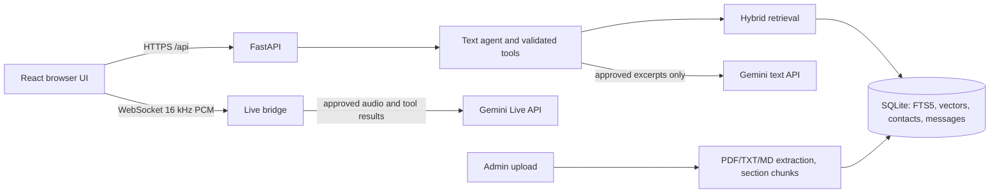

# Architecture and RAG

The original assignment PDF is a three-page scan. The initial source was transcribed by checking each rendered page image and placed in a Markdown file with page, section and project metadata. The unrelated sentence about leave and attendance data on page 1 was excluded as irrelevant source text. Source facts remain in the knowledge base, not in the system prompt.

New documents are extracted page by page. Markdown headings define sections; long sections are split into overlapping 180-word windows with a 150-word stride. SHA-256 IDs deduplicate identical chunk bodies. Gemini embeddings are stored as JSON vectors in SQLite. FTS5 indexes terms in the same database. Retrieval scores blend cosine similarity, keyword overlap, FTS5 and project match; a minimum score filters irrelevant results. This small-corpus design uses a full vector scan; a larger corpus should move vector search to an indexed engine without changing the agent contract.

Text chat loads the last 12 messages from its conversation ID, retrieves top source chunks using the current question plus recent user turns, and sends the evidence and conversation to Gemini. The SDK exposes ten backend functions for retrieval, facts, arithmetic and consented write actions. Lead, visit and callback tools refuse to write unless the current request includes a separately checked consent flag. The UI also offers a validated inquiry form.

The browser's AudioWorklet resamples microphone input to 16 kHz and quantizes it to little-endian 16-bit PCM. The backend WebSocket opens a Gemini Live session, forwards chunks, handles model tool calls, returns 24 kHz PCM and transcription events, and closes resources when the session ends. The browser schedules audio buffers and stops them on local speech or interruption. The backend holds the Gemini key throughout.

`ALLOW_KNOWLEDGE_EXPORT=false` blocks embedding, source OCR, Gemini text answers and Live at the server. This is a deliberate gate following automatic approval review. Text requests return attributed local source excerpts. Keyword retrieval, structured facts, inquiry capture and admin management remain local.

